<!-- Header -->
<h1 align="center">Hi, I'm Semyon 👋</h1>
<h3 align="center">Backend Developer | Python • Django • FastAPI</h3>

---

## 🚀 About Me

- Python Backend Developer with 3+ years of hands-on experience.
- Build REST APIs and backend services using Django, DRF, and FastAPI.
- Work with PostgreSQL, MySQL, Redis, and Celery for data storage and background processing.
- Develop third-party API integrations and asynchronous workflows.
- Containerize and deploy applications using Docker, Nginx, and CI/CD.
- Focus on maintainable architecture, performance, and practical AI integrations.

---

## 💻 Tech Stack

  <!-- Backend -->
  
  
  
  
  <!-- Databases -->
  
  
  
  
  <!-- DevOps -->
  
  
  

---

## 📊 GitHub Stats

  
  

  

## 📈 Contribution Activity

  

## 🧠 Coding Practice

  

---

## 🌐 Connect with Me

    
    
  

